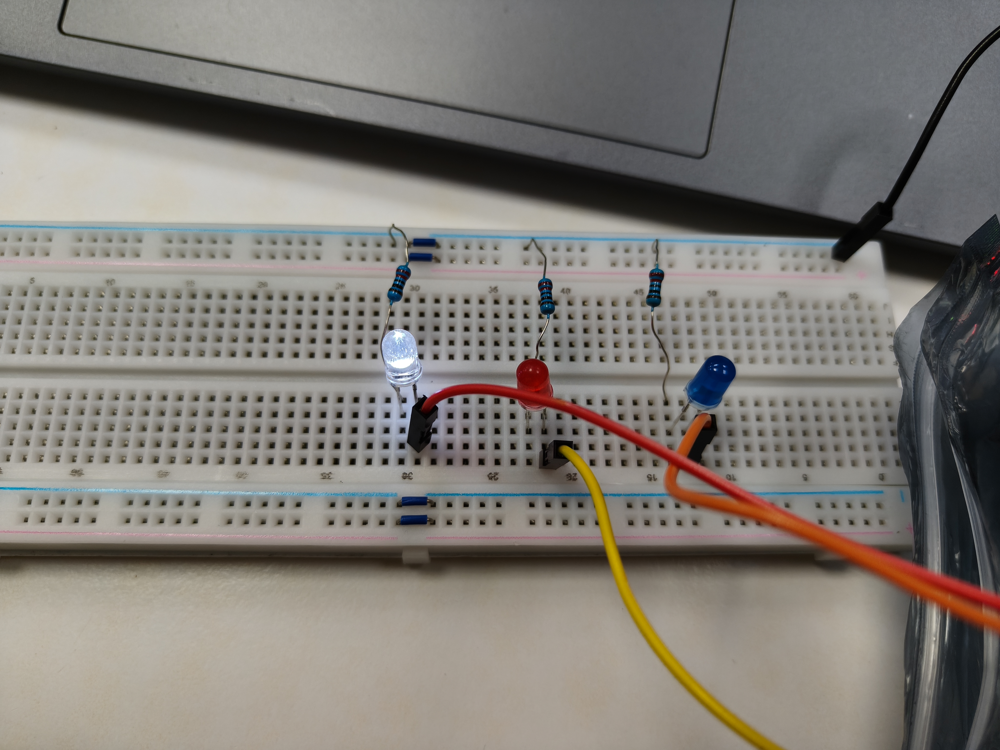
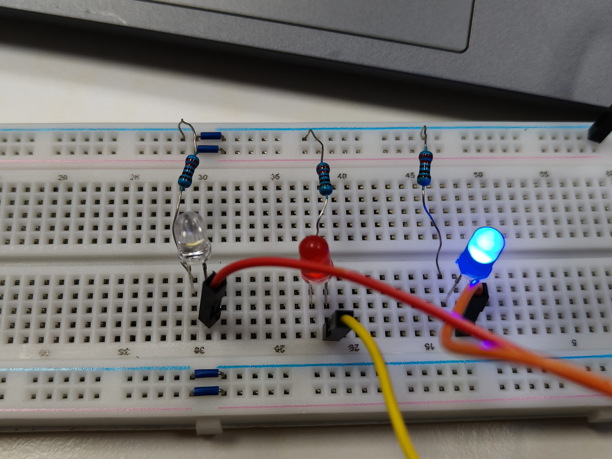
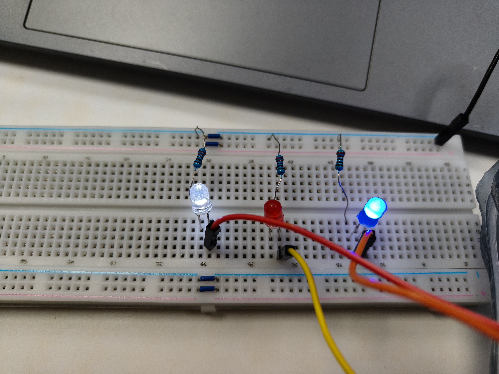
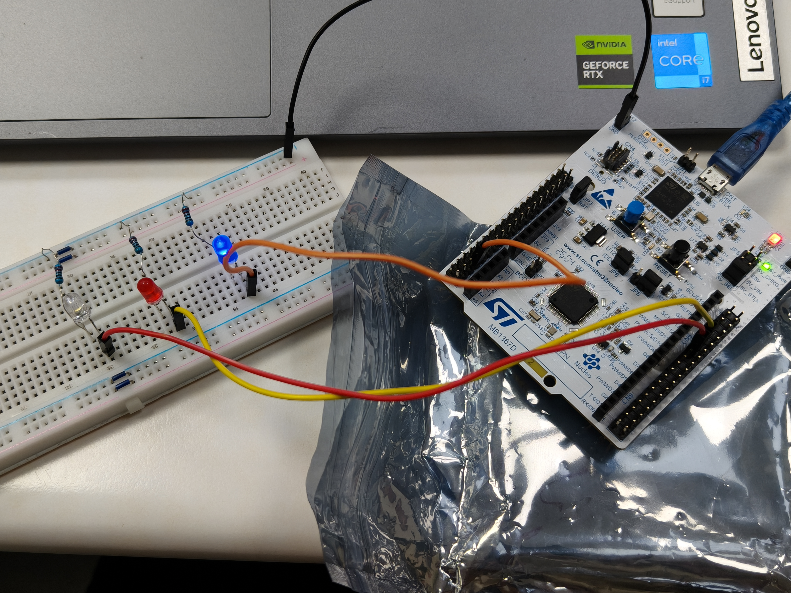
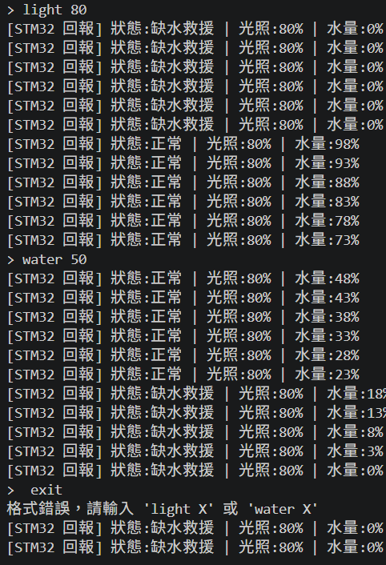

\# STM32 盆栽照明與缺水警報系統 (Plant Lighting \& Water Alarm)

基於 NUCLEO-G474RE 開發板與 STM32CubeIDE 打造的智慧盆栽模擬系統。具備自動水量流失模擬、PWM 補光燈與水量指示、硬體按鍵中斷控制，以及 Python 電腦端 UART 雙向通訊功能。

\## 🌟 核心功能

\* \*\*水量監控與警報\*\*：透過 TIM2 定時器模擬水量流失 (每 2 秒 -1%)。當水量低於 20% 時，PA5 警報燈以 10Hz 閃爍。

\* \*\*生長補光與水量指示\*\*：使用 TIM3 PWM 輸出，分別控制「生長補光燈」與「水量指示燈」的亮度 (0\~100%)。

\* \*\*一鍵補水/抽乾\*\*：透過 PC13 藍色按鍵 (EXTI 中斷含 50ms 去彈跳)，可瞬間將缺水狀態補滿，或將滿水狀態抽乾以測試警報。

\* \*\*遠端監控系統\*\*：透過 USART2 與電腦端 Python 程式連線，即時回報狀態，並可接收指令遠端設定亮度和水量。

\## 🛠️ 硬體設定 (Pinout)

\* \*\*MCU 時脈\*\*：HCLK 170 MHz

\* \*\*B1 按鍵 (PC13)\*\*：EXTI Rising Edge (無 Pull-up/down)

\* \*\*警報指示燈 (PA5)\*\*：GPIO Output (預設 Low)

\* \*\*生長補光燈 (TIM3\_CH1)\*\*：PWM 輸出

\* \*\*水量指示燈 (TIM3\_CH2)\*\*：PWM 輸出

\* \*\*UART 遠端通訊 (PA2/PA3)\*\*：USART2 (115200 8N1)

\## 💻 軟體架構與環境

\* \*\*開發環境\*\*：STM32CubeIDE / STM32CubeMX

\* \*\*函式庫\*\*：HAL 函式庫 (C語言)

\* \*\*電腦端測試程式\*\*：Python 3.x (`pyserial` 套件)

\## 🚀 如何使用

1\. 將本專案 Clone 至本機，使用 STM32CubeIDE 開啟。

2\. 編譯並燒錄至 NUCLEO-G474RE 開發板。

3\. 在電腦端安裝 pyserial：`pip install pyserial`。

4\. 修改 `main.py` 中的 COM 埠號 (如 `COM6`)，並執行 Python 腳本。

5\. 在終端機中可看到每秒回報的狀態，也可輸入 `light 80` 或 `water 50` 進行控制。

\## 以下附上圖片

